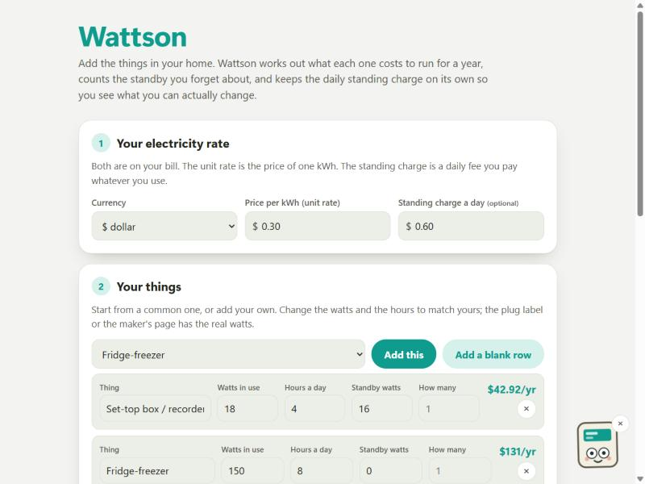

# Wattson

Work out what each thing in your home costs to run for a year, count the standby you forget about, and keep the daily standing charge separate so you can see what you can actually change.

Live: https://wattson.johanthegoat.xyz



## Why

Energy bills went up and stayed up, and most people cannot say what on it is costing them. In a UK survey only 28% could correctly say what the "standing charge" on their bill was, and a separate poll found 19% of people, close to 13 million adults, did not understand what a kWh is. In the US, 22% say they do not know what they are paying for on their power bill. So people guess, and they guess at the wrong things.

Two traps do most of the damage, and Wattson calls out both:

- **Standby.** Things that are "off" but left plugged in draw a trickle all year. A whole-house study measured standby loads of 14 to 169 watts per home, averaging 67 watts, which worked out to between about 5% and 26% of each home's yearly electricity. Televisions, set-top boxes and printers were the worst. Wattson shows the standby cost on its own line and flags any thing that is mostly standby, because a switched socket turns that off for free.
- **The standing charge.** It is a fixed daily fee you pay whatever you switch on, so it never belongs inside a per-appliance sum. Wattson keeps it apart from the running cost and shows it as its own figure.
- **Part of the year.** A space heater, an air conditioner or a fan only runs for a season, so costing it as if it ran every day of the year is badly wrong. Each thing has a "used" choice (all year, half the year, about four months, a few weeks) and Wattson scales its yearly cost, standby and all, to match. The seasonal presets start on the right setting, so a space heater is costed for the cold months, not July too.
- **Night rates (Economy 7).** If you're on a two-rate tariff with cheaper night hours, put your night rate in and tick "runs overnight" on anything you put on a timer, like a dishwasher, washing machine or storage heater. Wattson charges those at the night rate and shows what moving them to the cheap hours saves over a year against the day rate. Economy 7 only pays off if you shift enough use to the night, so the figure makes that trade-off visible instead of a guess.
- **The carbon.** The same kWh that cost you money also put CO₂ in the air. Wattson turns your year's electricity into kilograms of CO₂ using the grid's emission factor for your area, then into an easy "like driving X miles", so the footprint sits next to the cost. Factors used: UK ~0.21 kg/kWh (DESNZ 2024), US ~0.37 (EPA eGRID), euro area ~0.25 (EEA), Philippines ~0.65; the "miles" uses the US EPA figure of about 400 g CO₂ per car mile.

The sum itself is the one people mix up: power times time is energy, energy times the unit rate is money.

```
energy (kWh) = watts / 1000 * hours
cost         = energy (kWh) * unit rate
```

## How to use it

1. Put in your price per kWh and, if your bill has one, the daily standing charge. Both are on the bill.
2. Add the things in your home. Start from a common one and change the watts and hours to match yours, or add a blank row. The real watts are on the plug label or the maker's page.
3. Read the total for the year, see which few things make up most of it, and check the two callouts.

Everything runs in the browser. Nothing is uploaded; the share link carries your list in the address itself.

Say hello to **Watt**, the meter in the corner. Tap for a tip for where you are, and tap a few times fast if you want to see a spark fly.

## Sources

- Which?, energy bill transparency: only 28% knew what a standing charge is. https://www.which.co.uk/policy-and-insight/article/energy-bills-transparency-aT5uF9p6RIqE
- TechRadar, 35% do not understand their energy bills: 19% (near 13M UK adults) did not understand kWh. https://www.techradar.com/news/35-of-people-dont-understand-their-energy-bills-we-explain-the-key-terms
- Stacker / KVIA, US power-bill survey: 22% do not know what they are paying for. https://kvia.com/money/stacker-money/2025/03/25/power-bill-sticker-shock-22-of-americans-say-they-dont-even-know-what-theyre-paying-for/
- Lawrence Berkeley National Laboratory, Whole-House Measurements of Standby Power Consumption: 14-169 W per home, ~5-26% of annual use; TVs, set-top boxes and printers worst. https://eta-publications.lbl.gov/bibcite/reference/30550
- Lebot, Meier & Anglade (IEA/LBNL), Global Implications of Standby Power Use: standby is ~2% of OECD electricity; low-standby designs could cut it over 70%. https://eta-publications.lbl.gov/publications/global-implications-standby-power-use

## Run the tests

```
npm test
```

Pure functions in `src/engine.js`, covered by `test/engine.test.js`. No build step; open `index.html` to run it.

## Licence

MIT
